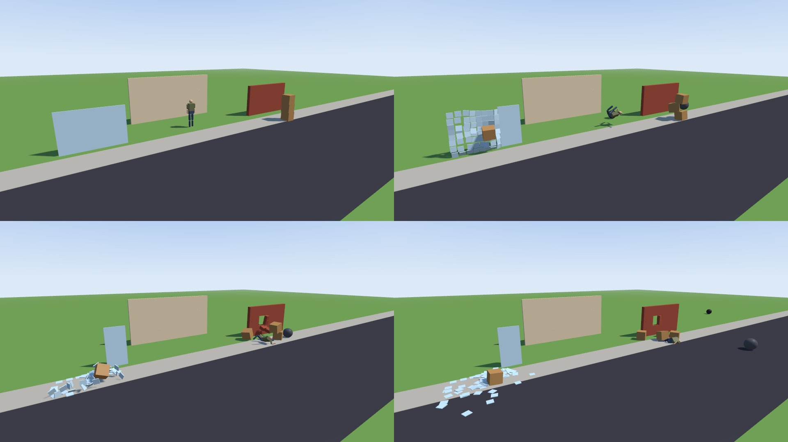

# Borrowed Time engine

Borrowed Time's own engine, in Rust. It's a clean-room build: written from public documentation, physics and
published body measurements. It uses no code from any other game. Goat Simulator's code isn't public, so any copy of
it online would be leaked, and none of it is used here. What the two share is the genre: physics comedy, where bodies
flop and things break.



## What's in it

| Part | File | What it does |
| --- | --- | --- |
| Physics | `crates/bt_engine/src/physics.rs` | Rapier 0.36 at a fixed 60 Hz, real gravity (9.81 m/s²), and the impulse of every hit, so game code can tell how hard things collide |
| Active ragdoll | `crates/bt_engine/src/ragdoll.rs` | A 75 kg body of 11 parts, with ball joints limited the way human joints are, and joint motors: strength 1 holds a pose, 0 flops. Segment masses follow Winter's anthropometry tables |
| Breakable walls | `crates/bt_engine/src/destruct.rs` | Walls made of panels (wood, glass, brick). A hit delivers E = J²/2m. A panel breaks into chunks once the energy reaches its strength, and panels left with nothing under them fall |
| Renderer | `crates/bt_engine/src/render.rs`, `shader.wgsl` | wgpu 30: instanced boxes, balls and capsules; one sun with 3×3 soft shadows; sky gradient; fog; 4× anti-aliasing. It renders off-screen for screenshots and tests, and runs on a real GPU or on Mesa's software driver |
| Demo | `crates/bt_demo/src/main.rs` | A street corner. A heavy ball knocks a body flying, a crate goes through a shop window, and a steel ball punches through bricks. Writes PNG frames and prints what broke |

## Measured

Run on a 4-core cloud machine with no GPU (Mesa llvmpipe, Vulkan), 25 November 2026:

| Check | Result |
| --- | --- |
| Free fall from 20 m | 2.033 s, g = 9.67 m/s² (1.4% off 9.81; the error is one 1/60 s step) |
| 30 kg crate into a 1 m² wood panel at 12 m/s (2,160 J) | breaks into 4 chunks |
| Same crate at 4 m/s (240 J) | panel holds |
| Column of 3 panels, bottom one knocked out | both panels above fall |
| Limp 75 kg body dropped from 2 m with a shove | stays in one piece (joints open at most 47 mm), at rest after 6 s |
| Body at full strength, pelvis held | head and arms stay at their rest heights (1.66 m and 1.06 m) |
| Demo, 118 rigid bodies at the end | 0.24 ms per physics step |
| Demo frame, 960×540, ~120 objects | 122 ms on the software renderer (a real GPU is far faster; not measured here) |

`cargo test -p bt_engine --release -- --nocapture` runs the checks and prints these numbers. 7 tests, all passing.

## Run it

```bash
cd engine
cargo test -p bt_engine --release -- --nocapture    # physics, ragdoll, walls, meshes
cargo run -p bt_demo --release -- out-dir 960 540   # renders out-dir/frame_1..4.png
```

On Linux without a GPU, install Mesa's software Vulkan driver first (`apt install mesa-vulkan-drivers`).

## Dependencies

All versions are pinned exactly in `Cargo.toml`, with `Cargo.lock` committed.

| Crate | Version | License | Why |
| --- | --- | --- | --- |
| rapier3d | 0.36.1 | Apache-2.0 | physics |
| wgpu | 30.0.2 | MIT or Apache-2.0 | graphics on Vulkan, Metal, DX12, GL and the web |
| glam | 0.33.12 | MIT or Apache-2.0 | math (the version Rapier uses, so the types match) |
| bytemuck | 1.25.2 | Zlib, MIT or Apache-2.0 | GPU buffer layouts |
| pollster | 1.0.3 | Apache-2.0 or MIT | waits for the GPU in the headless renderer |
| image | 0.25.10 (PNG only) | MIT or Apache-2.0 | saving frames |

`cargo audit` (25 Nov 2026) finds 0 vulnerabilities across 172 packages. It also reports 9 "unsound" warnings, all in
`heapless` 0.8.0, which comes in through Rapier's spatial index (`rstar` 0.13). They're fixed in heapless 0.9.4, which
that index can't use yet. They concern heapless data structures Rapier doesn't call on its hot paths. Every package's
license is permissive (MIT, Apache, Zlib, Unlicense).

## Next

1. A window and the web: winit for desktop, and the same renderer on a browser canvas through WebAssembly. The library
   already compiles for `wasm32`.
2. A character controller and a camera rig, then the game's own systems: the life clock, stashes, people and police.
3. Balance for the active ragdoll, so bodies stand and stagger instead of only holding a pose.
